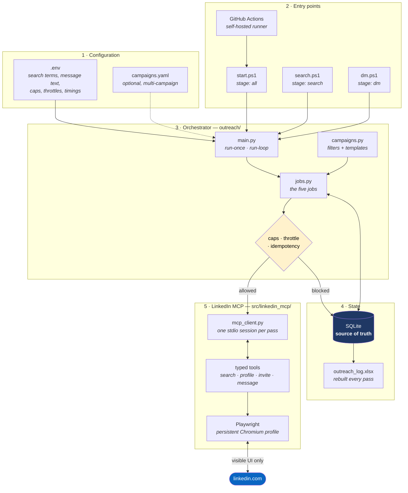
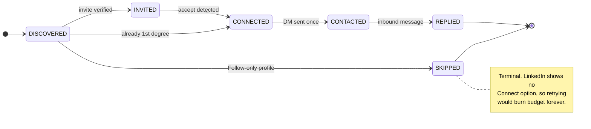
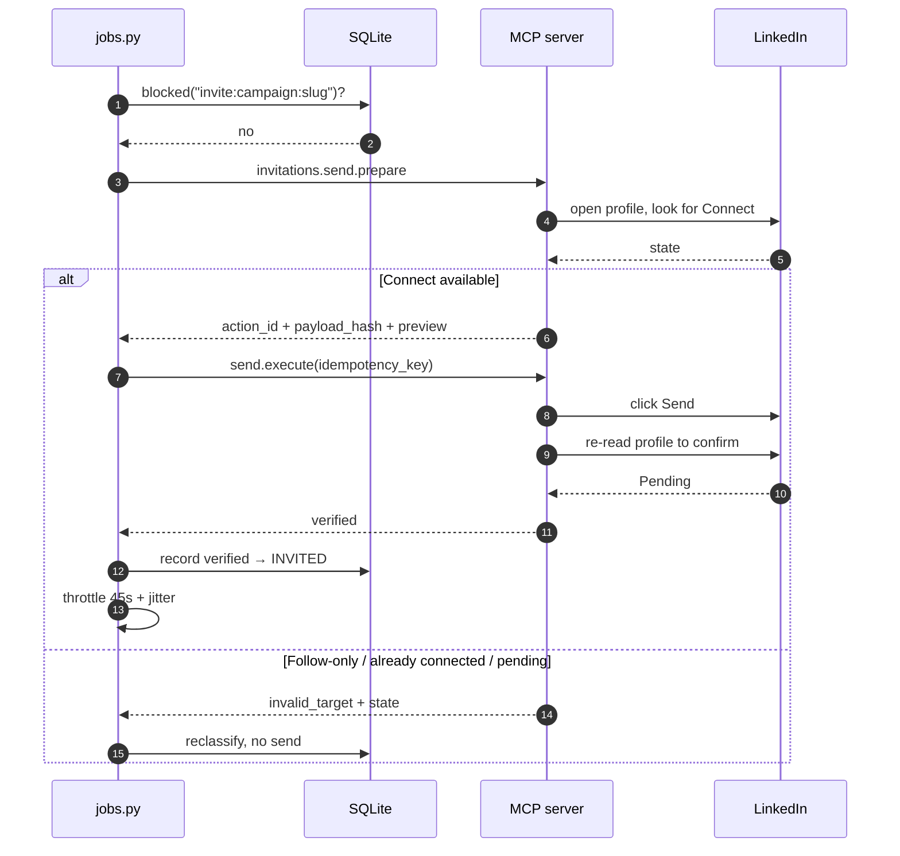

# LinkedIn Outreach CRM

Finds people on LinkedIn, sends them a connection request, waits for them to
accept, then sends one DM and watches for a reply. Runs by itself on a loop and
logs everything to Excel.

It never cold-DMs. A message only goes out after someone accepts.

---

## Architecture

Everything runs on your machine. There is no server, no API key, and no cloud
service — the MCP layer drives a real Chromium profile through LinkedIn's
normal web UI.



### Lead lifecycle

Every pass moves each lead at most one step, so a lead typically takes several
passes to travel the whole pipeline.



| Job | Reads | Writes |
| --- | --- | --- |
| `discover` | `people.search` | → DISCOVERED |
| `invite` | — | → INVITED / SKIPPED |
| `check-accepts` | `connections.list`, then `people.get` fallback | → CONNECTED |
| `send-dms` | — | → CONTACTED |
| `check-replies` | `messaging.conversation.get` | → REPLIED |

### How a send is made exactly once

This is the core correctness property. The action is committed to SQLite
**before** the spreadsheet is touched, so a crash can never cause a repeat.



An outcome of `uncertain` — LinkedIn acted but the confirmation page could not
be read — is recorded and **never retried automatically**, because a duplicate
invite is worse than a missing one. Those show up in the Excel file for you to
check by hand.

---

## Setup

```powershell
.\start.ps1                                    # installs everything, creates .env
notepad .env                                   # your search terms + message text
.\.venv\Scripts\linkedin-mcp.exe login         # sign in once, browser opens
.\start.ps1                                    # dry run - sends nothing
```

Check the output, then go live:

```powershell
.\start.ps1 -Live
```

That's it. It keeps running until you press Ctrl+C.

---

## Scripts

| Script | What it does |
| --- | --- |
| `.\start.ps1` | Everything: search, invite, DM, replies. Loops forever. |
| `.\search.ps1` | Only finds people and sends connection requests. |
| `.\dm.ps1` | Only messages people who already accepted, and checks replies. |

All three take the same flags:

| Flag | Meaning |
| --- | --- |
| *(none)* | Dry run — shows what it would do, sends nothing |
| `-Live` | Actually send |
| `-Once` | One pass then exit, instead of looping |
| `-Every 60` | Minutes between passes (default from `.env`) |

Why the split: `search.ps1` fills the pipeline, `dm.ps1` drains it. Run search
occasionally and DM often if you want more control. `start.ps1` does both.

---

## Config

Everything is in `.env`. Nothing is hardcoded. `.env.example` explains every
setting; these are the ones you'll actually touch:

```ini
OUTREACH_SEARCH_QUERY=business development partnerships crypto exchange
OUTREACH_CONNECTION_DEGREES=second,third_or_more

OUTREACH_INVITE_NOTE=Hi {first_name}, ...          # max 200 chars
OUTREACH_DM_BODY=Thanks for connecting...\n\n...   # \n = line break

OUTREACH_MAX_INVITES_PER_RUN=5
OUTREACH_DAILY_INVITE_CAP=20
OUTREACH_INVITE_DELAY_SECONDS=45                   # wait between invites
OUTREACH_DM_DELAY_SECONDS=60                       # wait between DMs
OUTREACH_LOOP_MINUTES=30                           # wait between passes
OUTREACH_DRY_RUN=true
```

Placeholders for the message text: `{first_name}` `{name}` `{headline}`
`{company}` `{location}`.

**If discovery finds nobody**, clear `OUTREACH_SEARCH_LOCATIONS`,
`_INDUSTRIES` and `_CURRENT_COMPANIES`. Those filters are brutal — a location
filter of `India` returned zero results on a real account here while the same
query without it returned plenty. The tool tells you when it thinks this is the
problem.

Also normal: LinkedIn hides about half of all search results behind "LinkedIn
Member" with no profile link. Those get skipped, so ask for more than you need.

---

## The Excel file

`outreach_log.xlsx`, rebuilt every pass. Four sheets: **Summary** (counts),
**Leads** (everyone, colour-coded, with timestamps per stage), **Events**
(audit trail), **Runs** (history).

It's a report, not an input — your edits get overwritten. Change `.env` instead.

---

## Safety

- Dry run by default. `-Live` is required to send anything.
- Two caps: per-run and per-day. Both low by default.
- Waits 45–60s between sends, with jitter. Don't lower this much.
- Never sends the same invite or DM twice, even if a run crashes mid-way.
- `uncertain` results are never retried — check those by hand in the Excel file.
- **SKIPPED** leads are people whose profile shows Follow instead of Connect.
  Nothing to fix, LinkedIn just offers no way to invite them.

Make sure your invite note and DM actually describe you — the examples in
`.env.example` are placeholders, not facts. And keep volumes sane;
[LinkedIn restricts accounts](https://www.linkedin.com/help/linkedin/answer/a1341387/)
that push automation too hard.

If this is business outreach rather than personal networking, the lead data is
personal data under DPDP/GDPR — worth checking with Legal before scaling up.

---

## GitHub Actions

`.github/workflows/outreach.yml` runs `start.ps1 -Once` every 30 minutes.

It needs a **self-hosted Windows runner** labelled `linkedin-outreach`. Hosted
runners can't work: they're wiped after each job, so the browser profile holding
your LinkedIn session dies, and logging in fresh from a datacentre IP every 30
minutes gets the account flagged.

Set the runner up on the machine where `.\start.ps1` already works
(**Settings → Actions → Runners → New self-hosted runner**), label it, install
it as a service. Manual runs let you pick dry-run/live and search/dm/all.

---

## When something breaks

| Problem | Fix |
| --- | --- |
| Changed code in `src/linkedin_mcp/`, nothing happened | Stale runtime on port 8000. `Get-NetTCPConnection -LocalPort 8000 -State Listen` then `Stop-Process -Id <pid> -Force` |
| Finds 0 people | Clear the location/industry/company filters in `.env` |
| `LinkedIn session is paused` | `.\.venv\Scripts\linkedin-mcp.exe login` |
| Lots of SKIPPED | Normal — those profiles only offer Follow |
| Excel file locked | Close it; the run still saved a timestamped copy |

---

## Licence

| Part | Copyright | Licence |
| --- | --- | --- |
| `outreach/`, `start.ps1`, `search.ps1`, `dm.ps1` — the CRM | **Unnati, 2026** | [Apache-2.0](outreach/LICENSE) |
| `src/linkedin_mcp/` — bundled MCP server | Prakhar Agarwal, 2026 | [Apache-2.0](LICENSE) |

The CRM is original work. The MCP server is
[linkedin-mcp-server](https://github.com/prakharagarwal-dev/linkedin-mcp-server),
bundled under Apache-2.0 with local bug fixes — see
[`docs/LOCAL_PATCHES.md`](docs/LOCAL_PATCHES.md), and re-apply them if you ever
update it or DMs will break. Attribution and modifications are recorded in
[`NOTICE`](NOTICE).

LinkedIn is a trademark of LinkedIn Corporation; this project is unaffiliated.
