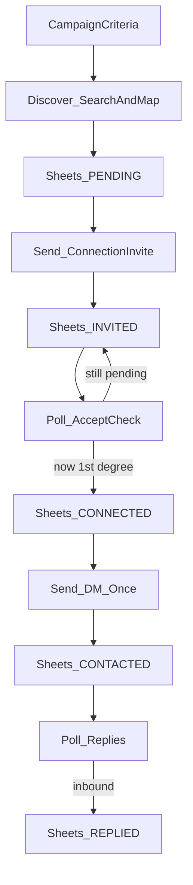

# Autonomous LinkedIn Outreach CRM (LinkedIn MCP–based)

## Overview

End-to-end local CRM using LinkedIn MCP — search/map leads, send connection requests, detect accepts, log everything in Google Sheets, then send a DM and watch for replies. No cold DMs; GitHub Actions not used for LinkedIn browser ops in MVP.

## Can this flow work?

**Yes.** This is the correct MVP shape for this MCP:

1. Autonomously **search and map** people matching campaign criteria
2. **Send connection requests** (optional note)
3. On later runs, **detect when they connect** and **update Google Sheets** with logged info
4. Once connected, **send the DM once**
5. Keep polling conversations for **replies** and log them in the sheet

The MCP itself is only the LinkedIn tool layer. Our Python orchestrator owns the autonomy, Sheets logging, and state machine.

## Capability verification

| Step in your flow | Supported? | MCP tools |
|---|---|---|
| Search relevant people | Yes | `linkedin.people.search` |
| Map/document profile | Yes | `linkedin.people.get` |
| Send connection request (+ note) | Yes | `linkedin.invitations.send.prepare/execute` |
| Detect they accepted / are 1st-degree | Yes | `linkedin.people.get` / connections surfaces + visible first-degree Message control |
| Send DM after connect | Yes | `linkedin.messaging.message.prepare/execute` |
| Cold DM before connect / InMail | **No** | Outside MCP capability |
| Read conversation + inbound/outbound | Yes | `linkedin.messaging.conversation.get` (`MessageDirection`) |
| Log everything in Sheets | Yes (our code) | Google Sheets API |
| Fully autonomous “system prompt brain” inside MCP | **No** | Orchestrator provides criteria + loop |

### Official `linkedin-api-python-client-main` — role here

**For this MVP: unused.** Do not wire it into invite/DM/discovery.

It is a real official Rest.li SDK (OAuth, approved products like Sign In profile / Ads / posts if provisioned), but LinkedIn does **not** give normal apps the messaging/inbox/people-search automation this CRM needs. Messaging is partner-only. So for the autonomous search → invite → connect → DM → reply flow, the official client cannot replace the MCP.

Keep that folder around only if you later want a separate official-API feature; otherwise ignore it for MVP.

## Locked end-to-end lifecycle

### Status model (Sheets + SQLite)

- `DISCOVERED` / `PENDING` — profile found and logged, not invited yet
- `INVITED` — connection request sent; `invite_sent_at` logged
- `CONNECTED` — accept detected; profile snapshot refreshed in sheet
- `CONTACTED` — DM sent exactly once; `message_sent_at`, `conversation_id`, `last_message_id` logged
- `REPLIED` — inbound message detected; `client_replied=YES`, `replied_at`
- `QUALIFIED` / `CLIENT` — manual or later rules

### Exactly-once protection

Idempotency key: `profile_slug + campaign_id` (fallback normalized LinkedIn URL).

Never resend invite or DM if SQLite already records success for that campaign, even if Sheets update failed mid-run.

## Locked product decisions

1. **LinkedIn layer:** `linkedin-mcp-server` (Playwright + persistent Chromium profile).
2. **Host:** local Windows machine + Task Scheduler `run-once` every 15–30 minutes. Not cloud GitHub-hosted runners for LinkedIn.
3. **Discovery criteria:** structured campaign config (keywords, titles, locations, companies, degrees) in config/Sheets `Campaigns` tab — not a free-form MCP system prompt. Optional later: LLM translates a natural-language brief into those filters.
4. **Outreach note vs DM:** invite note = short connect note; full `message` column = post-accept DM body.
5. **CRM:** Google Sheets = human-visible log; SQLite = crash-safe state.
6. **Rate limits:** small caps per run (e.g. discover N, invite ≤3–5, DM ≤3–5) with MCP pacing.

## Orchestrator jobs (each scheduled run)

1. **`discover`** — search → get profiles → append unique rows to Sheets
2. **`invite`** — for `PENDING`, send connection request once → `INVITED`
3. **`check_accepts`** — for `INVITED`, detect 1st-degree → refresh profile fields → `CONNECTED`
4. **`send_dms`** — for `CONNECTED` with no prior DM → send message once → `CONTACTED`
5. **`check_replies`** — for `CONTACTED`, compare latest message direction/id → `REPLIED`

CLI: `python -m src.main run-once` runs all five safely in order.

## Repository layout (to build)

Create `linkedin-outreach/` (sibling or app package alongside this MCP):

- `src/main.py` — CLI (`discover`, `invite`, `check-accepts`, `send-dms`, `check-replies`, `run-once`)
- `src/discovery.py` — search/map → Sheets
- `src/outreach.py` — invite + post-accept DM
- `src/accepts.py` — connection acceptance detection
- `src/replies.py` — inbound reply detection
- `src/sheets.py` — Google Sheets read/update
- `src/linkedin_mcp_client.py` — local MCP stdio/HTTP client
- `src/state.py` — SQLite idempotency
- `campaigns.example.yaml` — example search criteria
- `requirements.txt`, `.env.example`, `README.md`
- `scripts/setup_linkedin_login.md` — one-time MCP profile login

## Safety

- Pre-approve only execute tools needed for unattended runs: invite + message
- Never commit browser profile or Sheets credentials
- Conservative daily/run caps to reduce LinkedIn restriction risk
- Dry-run mode that logs intended actions without execute

## Out of MVP scope

- Cold DM / InMail before connection
- Pure GitHub-hosted LinkedIn automation without self-hosted runner + profile
- Full AI “system prompt graph explorer” UI
- Web dashboard / Postgres / Redis

## Implementation order

1. Extract MCP, login once, verify tools.
2. Live spike of full path on a test account: search → invite → accept → DM → reply read.
3. Sheets + SQLite schema + status machine.
4. Implement the five jobs with dry-run.
5. Local schedule `run-once`.
6. Optional later: natural-language criteria → filter compiler; self-hosted GHA runner.

## Implementation todos

- [ ] Extract linkedin-mcp-server zip, set up local login/profile, confirm session + tool list
- [ ] Spike people.search/get → invite → detect 1st-degree → DM → conversation direction on a safe test account
- [ ] Build Google Sheets client, SQLite idempotency schema, and full lead status lifecycle
- [ ] Implement autonomous search/map from campaign criteria into Sheets PENDING rows
- [ ] Implement invite → accept-check → DM → reply-check with dry-run and send caps
- [ ] Add CLI run-once + Windows Task Scheduler instructions; defer GHA until self-hosted runner exists
